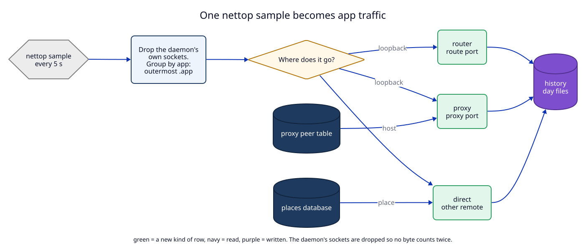

# 1. Traffic by app: a sampler in the daemon

**Status:** Proposed (not built).

## Context

The user asked (2026-11-02): "in the Traffic tab I want to see who uses what on
my Mac, and a separate window with a world map". Today the Traffic tab shows
only requests that LocalRouter itself carries: route requests and
forward-proxy requests (`get_logs`, `subscribe_logs`). A program that talks to
the internet directly is invisible.



## What macOS gives without an extension

`/usr/bin/nettop` ships with macOS. It runs as the logged-in user, without
root, and prints every TCP and UDP socket of every process with its byte
counts. Measured on this Mac (macOS 26, 2026-11-02):

```
nettop -L 0 -s 5 -x -n -d -J bytes_in,bytes_out
```

> **Changed in the build (D19 in [11](11-build-notes.md)):** this
> long-running mode uses about 1.5 CPU cores on macOS 27.0.1. The daemon
> runs `nettop -L 1 -x -n -J bytes_in,bytes_out` (one sample of totals,
> then exit) every 5 seconds and computes the change itself.

| Flag | Meaning |
|---|---|
| `-L 0` | logging mode, CSV, samples forever |
| `-s 5` | one sample every 5 seconds |
| `-x -n` | exact numbers, no name resolution (no DNS lookups) |
| `-d` | delta mode: the first sample is cumulative, every later sample holds only the bytes since the previous one |
| `-J bytes_in,bytes_out` | only these two columns |

One sample, shortened:

```
,bytes_in,bytes_out,
apsd.401,732854,2812087,
tcp4 192.168.0.155:57853<->17.57.146.10:5223,732854,2812087,
localrouterd.911,7915,45252,
tcp6 ::1.80<->::1.49368,699,620,
tcp4 *:443<->*:*,,,
```

Facts the parser must handle:

1. Each sample starts with the header line `,bytes_in,bytes_out,`.
2. A process line is `<name>.<pid>`. **The name is cut** to about 15
   characters (`localrouterd-de.913` is `localrouterd-dev`), so the name is
   only a fallback label. The real identity is the executable path, read with
   `proc_pidpath(pid)`.
3. A connection line follows its process. IPv4 writes `addr:port`, IPv6 writes
   `addr.port`, and a scope can follow an IPv6 address (`fe80::1%en0.55893`).
4. A listening socket has `*` on the remote side and empty counters. Skip it.
5. The first sample is cumulative. The sampler uses it only as the starting
   point and does not add it to history.

## Decision

### 1.1 Data source: `nettop` now, a network filter later

This ADR builds the **nettop sampler**. It needs no entitlement, no system
extension and no user approval, and it works in the ad-hoc signed `-dev`
instance.

A network filter (a Network Extension content filter, `NEFilterDataProvider`)
gives more: host names of direct connections, an exact owner of each flow,
and blocking. It needs a system extension, a provisioning profile, a user
approval in System Settings, and it cannot run in an ad-hoc build. It is
**not** in this ADR: see U1 and U2 in the
[manifest](08-semantic-change-manifest.md#12-unresolved-effects).

What the user loses with nettop, compared with the design canvas:

| Design shows | nettop gives | This ADR shows |
|---|---|---|
| `github.com` under Chrome | `140.82.121.4:443` | `140.82.121.4`, the network owner from the ASN database (`GitHub, Inc.`), and the place |
| a domain count per app | an address count | "41 addresses" |
| `shop.localhost` under Chrome | a connection to `::1.443` | the route host, from the request log (route traffic is known by name) |
| proxy hosts | a connection to the proxy port | the host names from the forward proxy (proxy traffic is known by name) |

### 1.2 One sampler, owned by the daemon

`apps/daemon/src/traffic.rs` starts `nettop` as a child process when the new
config field `traffic` is `true`, and stops it when it becomes `false`. If the
child exits, the daemon starts it again after 1, 2, 4 … up to 60 seconds, and
`status` reports `traffic: "restarting"` with the last error. A broken sampler
never touches routing or the proxy.

Debug builds read `LOCALROUTER_TEST_NETTOP`: a path to a program that prints
nettop-like CSV. Release builds ignore it, like the other `LOCALROUTER_TEST_*`
variables.

### 1.3 The `via` of each connection: router, proxy, direct

The user asked for three words in the UI: **router, proxy, direct**. Each
connection of an app gets one `via`:

| `via` | Rule (checked in this order) | Place on the map |
|---|---|---|
| `router` | remote is loopback and its port is the HTTP or HTTPS port, or the listen port of a TCP route | none: it stays on this Mac |
| `proxy` | remote is loopback and its port is the main proxy port or a proxy client port (ADR 09) | the places of the upstream connections the forward proxy made for it (1.4) |
| `direct` | anything else with a non-loopback remote | the place of the remote address |
| `direct`, no place | remote is loopback on any other port (a dev server reached by port) | none |

**The daemon's own sockets are never an app.** The daemon's pid is dropped
from every sample. Without this rule every route and proxy byte is counted
twice: once for the app and once for `localrouterd`.

Example. Chrome loads `https://shop.localhost/` and `github.com` through the
proxy. nettop shows:

```
Google Chrome He.5120
tcp6 ::1.61001<->::1.443,      3400, 600      → router
tcp4 127.0.0.1:61002<->127.0.0.1:8877, 96000, 9100   → proxy
localrouterd.911
tcp4 192.168.0.155:61010<->140.82.121.4:443, 96000, 9100   → dropped (daemon)
```

Result: Chrome has `router` 3.4 KB in and `proxy` 96 KB in. The daemon's
`140.82.121.4` connection is not counted again.

The word conflict: `docs/dictionary.md` says not to use "router" for a route.
The user chose "router" for this label on purpose. Task 10 adds a dictionary
entry **via (of an app connection)** with the three values, so the word has
one meaning here.

### 1.4 Proxy traffic: who asked, and where it went

The forward proxy knows the host and the upstream address of each request, but
not the app. nettop knows the app, but for proxy traffic only the connection to
the proxy port. They share one value: the client's local port.

`ForwardProxy` keeps a small table `peer_port → (client name, host, upstream
address, bytes in, bytes out)` for open connections and for connections closed
in the last 30 seconds. The sampler joins a `proxy` connection of an app on its
local port and moves the bytes to that host and upstream address. A connection
with no match keeps `host: null` and has no place.

This table is in memory only. It is not the HAR log (ADR 08) and it is filled
even when `proxy_log` is off.

### 1.5 What an "app" is

The key of an app row is the **app path**:

1. Read the executable path with `proc_pidpath(pid)`.
2. If the path has a `.app` folder in it, the app path is the **outermost**
   `.app`. `…/Google Chrome.app/Contents/Frameworks/…/Google Chrome Helper.app/…`
   becomes `/Applications/Google Chrome.app`.
3. Otherwise the app path is the executable path (`/opt/homebrew/bin/node`).
4. Paths under `/System/`, `/usr/libexec/`, `/usr/sbin/` and `/usr/bin/` group
   into one row **macOS services**, with the processes listed inside.
5. A process that exited before `proc_pidpath` ran keeps its nettop name and
   gets `path: null`. Its row shows "(exited)" and has no app checks.

Each app row also carries the list of executable paths seen under it and the
current pids. The app checks (change 3) run on executable paths.

### 1.6 History

The daemon is the only writer of the data folder, so it keeps the history.

| Store | Shape | Size limit |
|---|---|---|
| memory | the last 60 minutes, one bucket per 5 seconds, per app and `via` | bounded by the number of apps |
| `<data>/traffic/YYYY-MM-DD.ndjson` | one line per minute per active pair (app, `via`, remote address, port, protocol): `{"t":…,"app":…,"via":…,"remote":…,"port":…,"proto":…,"host":…,"in":…,"out":…}` | the files are removed after `traffic_history_days` days, and the oldest first when they pass 500 MB together |

A line is appended at the end of each minute. A crash loses at most the open
minute. A file is NDJSON, so a half-written last line is dropped when read.

Config fields (all left out of `config.json` when unset):

| Field | Default | Meaning |
|---|---|---|
| `traffic` | `false` | run the sampler |
| `traffic_history_days` | `7` | `1`, `7` or `30` |
| `traffic_places` | `false` | look up places (change 2) |

The sampler is **off by default**. A user who never turns it on gets no
`nettop` process and no `traffic/` folder.

### 1.7 Socket API 1.9

Additive, so `API_VERSION` goes from `1.8` to `1.9`.

| Method | Params | Reply |
|---|---|---|
| `get_app_traffic` | `range`: `1h`, `24h`, `7d`, `30d`; optional `app` (an app path) | `buckets` (60 or 96 of `{t, in, out}`), `apps` (each with `app`, `name`, `paths`, `pids`, `in`, `out`, `by_via`, `addresses`, `spark` of 12 values), `remotes` (each with `app`, `address`, `port`, `proto`, `host`, `asn_org`, `place`, `via`, `in`, `out`), `totals` with `by_via`, and `sampler` (`off`, `running`, `restarting`) |
| `update_geo_db` | none | `{database, date, bytes}` or an error (change 2) |
| `set_config` | gains `traffic`, `traffic_history_days`, `traffic_places` | unchanged |

The app asks again every 2 seconds while the popover shows the Apps view, and
every 5 seconds while the map window is open. `1h` is served from memory. A
longer range reads the day files once and keeps the result until the next
minute line is written, so the map window does not read 30 files every 5
seconds (gap G5). No new event type: polling is
enough at this rate and keeps `subscribe_logs` as it is.

The MCP server keeps exactly nine tools. No CLI command is added in this ADR.

## Tests

T1 to T4 and T6 to T8 in the [test plan](09-test-plan.md), and E1.
