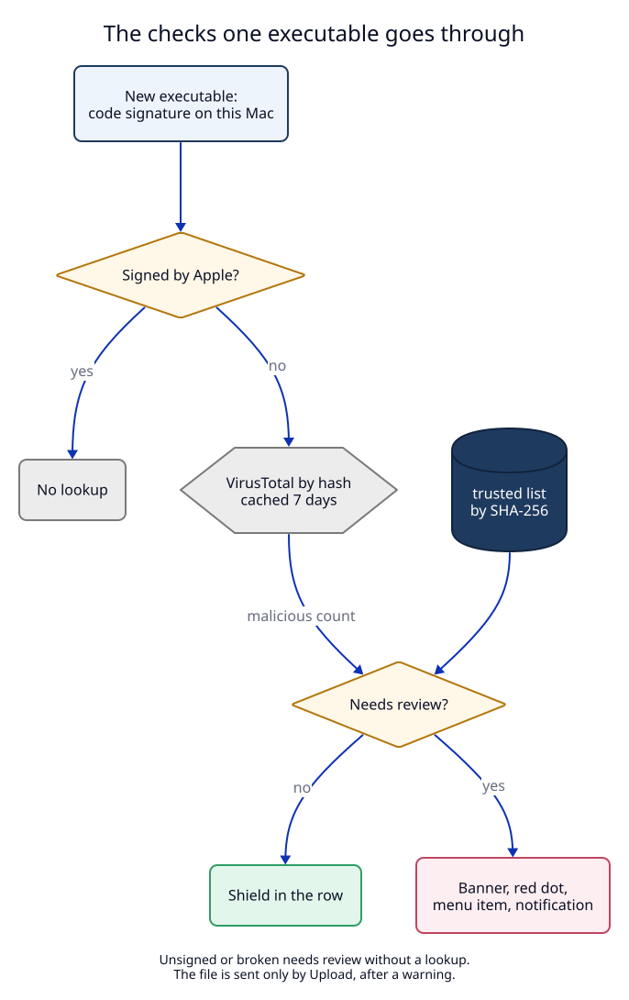

# 3. App checks: code signature and VirusTotal

**Status:** Proposed (not built).

## Context

The user asked (2026-11-02): "we need a way to check that an app is genuine,
and maybe send it to VirusTotal", and "so I click and understand what it is".
A row in the Apps view says nothing about who made the program.

## Decision

All checks run in the **app** (Swift), not in the daemon. They need
Security.framework, the Keychain and a dialog, and their results are only
shown in the app. They are not stored in the data folder, so the rule "the
daemon is the only writer of the data folder" holds.

### 3.1 Code signature: on this Mac, no network

`AppIdentity.check(path:)` in `LocalRouterKit/AppIdentity.swift`:

1. `SecStaticCodeCreateWithPath` on the executable path.
2. `SecStaticCodeCheckValidityWithErrors` with
   `kSecCSCheckAllArchitectures | kSecCSStrictValidate`.
3. `SecCodeCopySigningInformation` with `kSecCSSigningInformation`: the team
   id, the certificate chain, the flags.
4. The requirement `notarized` (`SecRequirementCreateWithString`) for
   notarization.
5. SHA-256 of the executable file, read in 1 MB pieces.

The result is one of:

| Status | Rule | Shown as |
|---|---|---|
| `apple` | the requirement `anchor apple` holds | grey shield, "Apple" |
| `developerID` | valid, Developer ID or Mac App Store certificate | green shield, the signer and team id, "notarized" or "not notarized" |
| `adhoc` | valid, flag `kSecCodeSignatureAdhoc` | label `ad-hoc signed` |
| `unsigned` | `errSecCSUnsigned` | red shield, "not signed" |
| `broken` | any other validation error | red shield, "signature does not match the file" |

A running program can differ from the file on disk after an update. The check
is of the file, and the details window says "file on disk".

### 3.2 VirusTotal: the hash, never the file

`VirusTotal.lookup(sha256:)` in `LocalRouterKit/VirusTotal.swift`:

- `GET https://www.virustotal.com/api/v3/files/{sha256}` with the header
  `x-apikey`.
- `200`: read `data.attributes.last_analysis_stats` (`malicious`,
  `suspicious`, `undetected`, `harmless`),
  `popular_threat_classification.suggested_threat_label` and
  `first_submission_date`.
- `404`: "VirusTotal does not know this file".
- `429`: wait, and try again after the next minute.

Rules:

1. Only when **Look up new programs on VirusTotal** is on **and** a key is
   saved.
2. Never for `apple` programs.
3. One lookup per SHA-256, kept 7 days; **Check again** forces a new one.
4. At most 4 lookups a minute and 500 a day (the public API limits). The
   Settings page shows "112 of 500 lookups today".
5. The API key is stored in the Keychain only (generic password, service named
   by the instance rule of ADR 04). It is never written to `config.json`,
   `UserDefaults`, a log or a reply.

The results cache is `~/Library/Caches/<bundle id>/app-checks.json`
(SHA-256 → signature result, VirusTotal result, time). It is a cache: deleting
it costs only new lookups.

### 3.3 Upload: only by an explicit action

**Upload file to VirusTotal…** in the details window. Before the upload a
dialog says: "VirusTotal shares uploaded files with security companies. Do not
upload a file that holds your own or your company's data." The upload function
takes a value that only the dialog's confirm button creates, so no other code
path can call it.

Files up to 32 MB use `POST /api/v3/files`. Larger files use
`GET /api/v3/files/upload_url` first. After the upload the app looks the hash
up again after 60 seconds.

### 3.4 When an app needs review

An app **needs review** when one of its executables:

- is `unsigned` or `broken`, or
- has `malicious ≥ 2` on VirusTotal, or
- is `adhoc` and the setting "Also warn about ad-hoc signed programs" is on
  (off by default, because Homebrew, `cargo` and the user's own builds are
  ad-hoc signed).

`malicious == 1` shows the number in amber but does not need review: one
engine alone is often a false positive.

The user can mark an executable **trusted**. The mark is keyed by its
SHA-256, so a changed file is not trusted any more. The list is in
`UserDefaults` and in Settings → Traffic → Trusted programs.

What "needs review" changes:

| Place | Change |
|---|---|
| menu bar icon | a red dot (setting "Show a red dot", on by default) |
| right-click menu | **Review \<app\>…** in the Traffic group |
| Apps view | a red banner above the list with **Review** |
| map window | a red shield in the app list |
| Settings sidebar | a red dot next to Traffic |
| notification | one per new executable (setting "Send a notification", on by default); when more than 3 need review within 10 minutes, one notification "5 programs need review" instead (gap G7) |

### 3.5 The details window

Opened by clicking an app row, **Review**, or the menu item. Layout from the
canvas artboard `AppInfo.dc.html`: header (name, path, pid, who started it,
first seen), the verdict line, the **Code signature** card, the **VirusTotal**
card, **What is this?** (change 4), the network table, the upload box, and
**Show in Finder**, **Copy path**, **Quit process**.

**Quit process** sends `SIGTERM` after a confirm dialog. It is the only action
in this ADR that changes another program. It is not shown for `apple`
programs: stopping `mDNSResponder` stops DNS for the whole Mac (gap G6).

## Tests

T9 to T11 in the [test plan](09-test-plan.md), and M4, M5.
