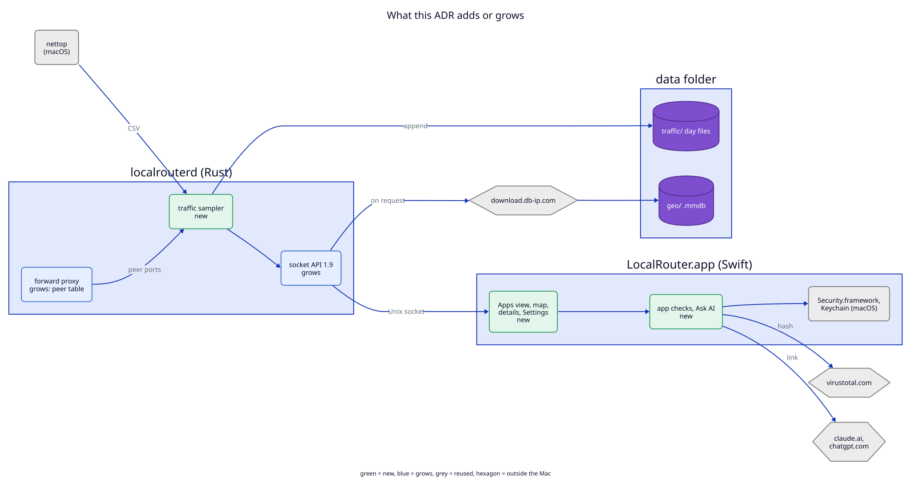

# 6. Where the code lives

**Status:** System view: as-built, with the additions of this ADR marked.
Inside view (the table): proposed (not built).

The view leaves out the parts this ADR does not touch: the TLS listeners, the
TCP routes, the script engine, the HAR writer, the CLI and the MCP server.

## Components

| Component | State | Note |
|---|---|---|
| `/usr/bin/nettop` | reused (macOS) | child process of the daemon while `traffic` is on |
| `libs/core/src/traffic/nettop.rs` | new | parses CSV samples; no I/O |
| `libs/core/src/traffic/attribute.rs` | new | `via` rules, the daemon-pid drop, the proxy join, app paths |
| `libs/core/src/traffic/history.rs` | new | 5-second memory buckets, minute lines, reading the day files back, retention |
| `libs/core/src/traffic/geo.rs` | new | `maxminddb` lookups; the download URL rule |
| `libs/core/src/forward.rs` | grows | the `peer_port` table for the proxy join |
| `libs/core/src/api.rs` | grows | `get_app_traffic`, `update_geo_db`, config fields, `API_VERSION` 1.9 |
| `libs/core/src/config.rs` | grows | `traffic`, `traffic_history_days`, `traffic_places` |
| `apps/daemon/src/traffic.rs` | new | starts and restarts nettop, `proc_pidpath`, writes `traffic/`, answers `get_app_traffic` |
| `apps/daemon/src/socket.rs`, `daemon.rs` | grow | the two methods, the config fields |
| `<data>/traffic/*.ndjson` | new store | written by the daemon only |
| `<data>/geo/*.mmdb` | new store | written by the daemon only, on request |
| `LocalRouterKit/Api.swift` | grows | Swift copy of the new types |
| `LocalRouterKit/AppIdentity.swift` | new | code signature check, SHA-256 |
| `LocalRouterKit/VirusTotal.swift` | new | lookup, upload, limits, Keychain key |
| `LocalRouterKit/AppChecks.swift` | new | the cache file, the "needs review" rule, trusted list |
| `LocalRouterKit/AskAI.swift` | new | the question, the links |
| `LocalRouterKit/MapProjection.swift` | new | projection, arcs, time zone places |
| `LocalRouterKit/AppMenu.swift`, `SettingsTree.swift`, `Traffic.swift` | grow | menu items, the Traffic page, app grouping helpers |
| `LocalRouter/Views/AppsView.swift`, `TrafficMapView.swift`, `AppDetailsView.swift` | new | screens |
| `LocalRouter/TrafficMapWindowController.swift`, `AppDetailsWindowController.swift` | new | windows, the same pattern as `SettingsWindowController` |
| `~/Library/Caches/<bundle id>/app-checks.json` | new store | the app's own cache, not the data folder |
| Keychain item for the VirusTotal key | new store | the app's own |
| `virustotal.com`, `download.db-ip.com` | external | the only new outbound hosts |

## Two arrows that cross the old boundaries

1. **The daemon downloads from `download.db-ip.com`.** Until now only the
   forward proxy connected to other machines, through `upstream.rs`. The
   download uses the same `upstream::platform_tls()` and runs only when the
   user asks for it.
2. **The app calls `virustotal.com` itself**, like the updater calls GitHub.
   The key is in the app's Keychain, and the daemon never sees it.
