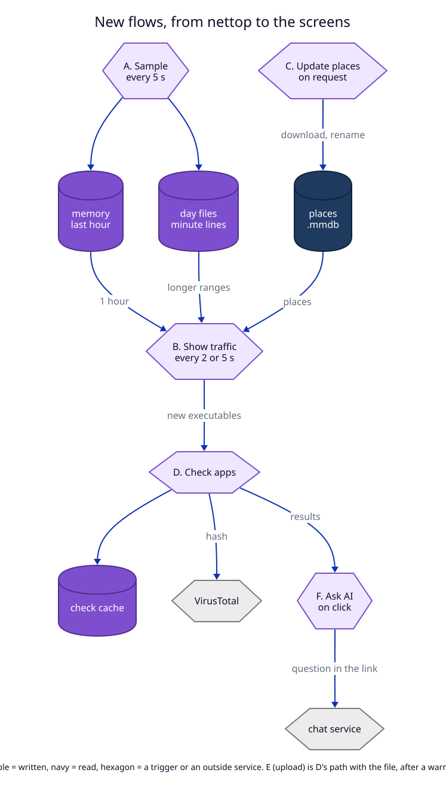

# 7. Data flow

These are the flows the design **will** create. Nothing is built yet.

| Flow | new/changed/removed | Trigger | Writes | Reads |
|---|---|---|---|---|
| A. Sampling | new | every 5 s while `traffic` is on | daemon memory; one line per active pair per minute in `<data>/traffic/YYYY-MM-DD.ndjson` | nettop CSV, `proc_pidpath`, the proxy `peer_port` table, config ports |
| B. Showing traffic | new | Apps view open (every 2 s), map window open (every 5 s) | nothing | `get_app_traffic`: memory for `1h`, day files for longer ranges, `geo/*.mmdb` for places |
| C. Places database | new | the user turns on places or presses Update | `<data>/geo/*.mmdb` (via `.part` and rename) | `download.db-ip.com` |
| D. App checks | new | a new executable path appears in a reply of flow B | `app-checks.json` in the app's Caches | the executable file, Security.framework, `virustotal.com` (hash only), Keychain |
| E. Upload | new | **Upload file to VirusTotal…** and the confirm dialog | nothing local; the file goes to VirusTotal | the executable file |
| F. Ask AI | new | **Ask Claude** or **Ask ChatGPT** | nothing | the check results and flow B data, to build the question |
| G. Requests view | changed | as today | as today | as today; only the `Apps / Requests` switch is new |

## Where each write ends

- **A.** A minute line is one `write` of one line with `O_APPEND`. There is no
  transaction: a line is either whole or the reader drops it (NDJSON). Memory
  buckets are lost on a daemon restart; the day files keep everything older
  than the open minute. Decided in [01](01-app-traffic.md), 1.6.
- **C.** The new file replaces the old one by `rename` only after
  `maxminddb` opened it. A crash before the rename leaves a `.part` file that
  the next download overwrites. Decided in [02](02-places-and-map.md), 2.2.
- **D.** The cache file is replaced whole (write to a temp file, then rename).
  Losing it costs only new lookups. Decided in [03](03-app-checks.md), 3.2.
- **E** and **F** write nothing on this Mac. What they send cannot be taken
  back (see the manifest, Rollback).
